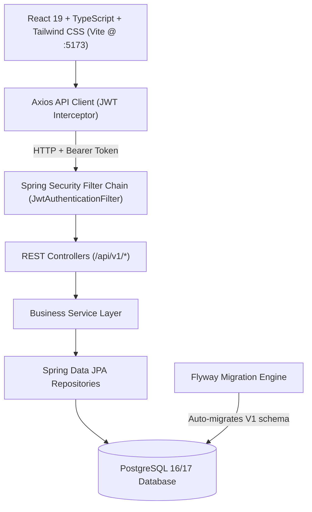
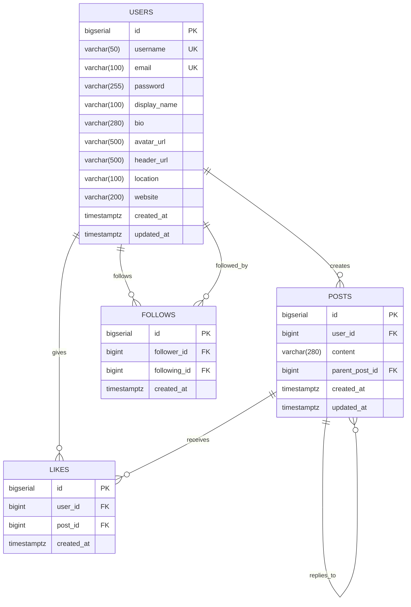

# 🕊️ XClone — Full-Stack Twitter/X Social Media Platform

A complete, production-grade social media web application inspired by X (formerly Twitter), engineered as a **modular monolith** with **Java 21**, **Spring Boot 3.4**, **Spring Security (stateless JWT)**, **PostgreSQL 17**, **Flyway**, **React 19**, **TypeScript**, and **Tailwind CSS**.

---

## 📑 Table of Contents
1. [Project Overview](#-project-overview)
2. [Key Features](#-key-features)
3. [System Architecture](#-system-architecture)
4. [Database Design & ER Diagram](#-database-design--er-diagram)
5. [Tech Stack](#-tech-stack)
6. [API Documentation & Examples](#-api-documentation--examples)
7. [Getting Started & Local Setup](#-getting-started--local-setup)
   - [Prerequisites](#prerequisites)
   - [Database Setup](#1-database-setup)
   - [Backend Setup](#2-backend-setup)
   - [Frontend Setup](#3-frontend-setup)
8. [Automated Testing & Verification](#-automated-testing--verification)
9. [Security Implementation](#-security-implementation)
10. [Known Limitations & Future Roadmap](#-known-limitations--future-roadmap)

---

## 🌟 Project Overview

**XClone** is built for software engineering portfolio evaluation and technical interviews. It is designed around clean software engineering principles:
- **Clean Architecture**: Controller-Service-Repository separation of concerns without business logic leakage.
- **Strict Zero-Lombok Compliance**: Explicit constructors, getters, setters, and entity lifecycle hooks for maximum clarity and debuggability.
- **Server-Side Identity Verification**: Authenticated identity is securely derived strictly from the Spring SecurityContext / JWT Principal—never trusting client-supplied author IDs.
- **Normalized Relational Schema**: 3NF relational design with database-level uniqueness constraints and cascading referential integrity.
- **Modern Responsive UI**: Custom dark-mode UI styled with Tailwind CSS, responsive 3-column desktop layout, mobile drawer navigation, live search, optimistic like updates, and threaded discussions.

---

## 🚀 Key Features

### 🔐 Authentication & Accounts
- **User Registration & Login**: Validated inputs with BCrypt password hashing.
- **Stateless JWT Security**: HMAC-SHA256 tokens using modern JJWT 0.12.x.
- **User Profiles**: Custom display names, handles, avatars, header banners, bios, locations, and website links.
- **Account Self-Management**: In-app modal to update profile metadata in real-time.

### 📝 Posts & Threaded Conversations
- **Post Composer**: 280-character limit with dynamic circular progress indicators and hotkey support (`Ctrl` / `Cmd` + `Enter`).
- **Threaded Replies**: Native replies with hierarchical parent-child references.
- **Post Ownership Enforcement**: Strict backend authorization forbidding non-owners from editing or deleting tweets.
- **Optimistic Interactions**: Instant like/unlike response with synchronized counter states.

### 👥 Social Graph & Feeds
- **Follow / Unfollow System**: Normalized follow graph preventing duplicate links or self-following.
- **Personalized Home Timeline ("Following")**: Feed curated strictly from accounts followed by the user + the author's own posts, ordered newest-first.
- **Global Explore Feed ("For You")**: Discover public posts across the entire community.
- **User Profile Timelines**: Tabbed views for user's tweets and liked posts.

### 🔍 Discovery & Live Search
- **Instant Search**: Real-time debounced query search for finding both users and tweet content.
- **Quick-Follow Cards**: "Who to follow" recommendations with real one-click follow toggles.

---

## 🏛️ System Architecture



### Backend Directory Layout
```
backend/src/main/java/com/xclone/
├── XCloneApplication.java
├── common/             # Global envelopes, exception advice, validation models
├── config/             # CORS registry, Redis conditional beans, WebMvc
├── security/           # JWT provider, UserPrincipal, auth filter, SecurityFilterChain
├── auth/               # Register, login, me endpoints & AuthService
├── user/               # User entity, repository, profile update, user search
├── post/               # Post entity, repository, thread replies, ownership checks
├── like/               # Like entity, unique constraints, toggle like service
├── follow/             # Follow entity, follower/following counts, graph service
├── feed/               # Chronological timeline algorithms (Home vs Explore)
└── search/             # Multi-entity search service (users & post text)
```

---

## 🗄️ Database Design & ER Diagram

The database schema is managed declaratively via Flyway migrations located in `backend/src/main/resources/db/migration/V1__init_schema.sql`.

### Relational Schema Diagram


### Key Schema Constraints
- **Uniqueness**: `uk_users_username` on `users(username)`, `uk_users_email` on `users(email)`.
- **Duplicate Prevention**: `uk_follows_pair` on `follows(follower_id, following_id)` and `uk_likes_user_post` on `likes(user_id, post_id)`.
- **Integrity**: `chk_follows_no_self_follow` enforces `follower_id <> following_id`.
- **Cascade Deletion**: All child records (likes, replies, follows) cascade-delete automatically upon entity removal.
- **Performance Indexes**: B-tree indexes on `posts(created_at DESC)`, `posts(user_id)`, `follows(follower_id)`, `follows(following_id)`.

---

## 💻 Tech Stack

| Domain | Technology | Purpose |
|---|---|---|
| **Backend Framework** | Spring Boot 3.4.3 | REST API and Monolith Backend |
| **Language** | Java 21 LTS | Core backend business logic |
| **Security** | Spring Security 6 & JJWT 0.12.6 | Stateless JWT authorization & BCrypt hashing |
| **ORM / Data** | Spring Data JPA / Hibernate | Relational persistence & query generation |
| **Migrations** | Flyway | Versioned database migrations |
| **Primary DB** | PostgreSQL 16/17 | Production relational data store |
| **Test DB** | H2 In-Memory Database | Fast, isolated test suite execution |
| **Frontend Framework** | React 19 + TypeScript | Component-based single-page web app |
| **Bundler & Tooling**| Vite | Fast ESM development & optimized production build |
| **Styling** | Tailwind CSS 3.4 | Consistent modern dark-mode design system |
| **Icons & Utils** | Lucide React & Date-fns | Iconography and relative time formatters |
| **HTTP Client** | Axios | Intercepted API calls with automatic Bearer token injection |

---

## 📡 API Documentation & Examples

All API responses follow a standardized JSON envelope:
```json
{
  "success": true,
  "message": "Operation description",
  "data": { ... },
  "timestamp": "2026-10-24T13:45:00.000Z"
}
```

### Core Endpoints

#### 1. Authentication
- `POST /api/v1/auth/register` — Register a new account.
- `POST /api/v1/auth/login` — Authenticate and receive a JWT Bearer token.
- `GET /api/v1/auth/me` — Retrieve the currently authenticated user session.

#### 2. Posts & Replies
- `GET /api/v1/feed/home?page=0&size=20` — Chronological feed from followed users (Requires auth).
- `GET /api/v1/feed/explore?page=0&size=20` — Public explore timeline (Public).
- `POST /api/v1/posts` — Create a new top-level tweet or threaded reply.
  ```json
  {
    "content": "Exploring Java 21 and Spring Boot 3 with modern React!",
    "parentPostId": null
  }
  ```
- `GET /api/v1/posts/{id}` — Retrieve post and author details.
- `PUT /api/v1/posts/{id}` — Edit post content (owner only).
- `DELETE /api/v1/posts/{id}` — Delete post and cascade replies (owner only).
- `GET /api/v1/posts/{id}/replies` — Retrieve threaded comments.

#### 3. Social Interactions
- `POST /api/v1/posts/{id}/like` — Like a post.
- `DELETE /api/v1/posts/{id}/like` — Unlike a post.
- `POST /api/v1/users/{username}/follow` — Follow a user.
- `DELETE /api/v1/users/{username}/follow` — Unfollow a user.

#### 4. Profiles & Search
- `GET /api/v1/users/{username}` — Public profile metadata with follower/following counts.
- `PUT /api/v1/users/profile` — Update bio, location, website, avatar, banner.
- `GET /api/v1/search/users?q=keyword` — Search users by name or handle.
- `GET /api/v1/search/posts?q=keyword` — Search posts by text content.

---

## 🛠️ Getting Started & Local Setup

### Prerequisites
- **Java 21 LTS** (`java -version`)
- **Maven 3.9+** (`mvn -v`)
- **Node.js 18+ & npm 9+** (`node -v`)
- **PostgreSQL 16/17** (or Docker)

---

### 1. Database Setup

#### Option A: Local PostgreSQL Service
Create the database and developer user using `psql`:
```sql
CREATE DATABASE xclone_db;
CREATE USER xclone_user WITH ENCRYPTED PASSWORD 'xclone_password';
GRANT ALL PRIVILEGES ON DATABASE xclone_db TO xclone_user;
```

#### Option B: Docker Compose
```bash
docker compose up -d postgres
```

---

### 2. Backend Setup
1. Copy the environment variables:
   ```bash
   cp .env.example .env
   ```
2. Build and run automated tests:
   ```bash
   cd backend
   mvn clean test
   ```
3. Start the Spring Boot backend:
   ```bash
   mvn spring-boot:run
   ```
   The backend will start at `http://localhost:8080`. Flyway will automatically execute `V1__init_schema.sql` on startup.

---

### 3. Frontend Setup
1. Install dependencies:
   ```bash
   cd frontend
   npm install
   ```
2. Run the Vite development server:
   ```bash
   npm run dev
   ```
   The application will be accessible at `http://localhost:5173`.

---

## 🧪 Automated Testing & Verification

The project includes unit, mock, and slice integration tests across both the backend and frontend:

### Backend Tests
Execute all tests with:
```bash
cd backend
mvn test
```
**Test Coverage Includes:**
- `AuthServiceTest`: User registration, duplicate username/email rejection, login validation.
- `JwtTokenProviderTest`: JJWT token creation, signature validation, expired token rejection.
- `PostServiceTest`: Post creation, reply threading, strict owner authorization for edit and delete.
- `LikeServiceTest`: Liking, unliking, and database constraint duplicate-like prevention.
- `FollowServiceTest`: Following, unfollowing, self-follow prevention, duplicate follow prevention.
- `FeedServiceTest`: Follower timeline fan-out aggregation and newest-first chronological sorting.
- `AuthControllerTest`: MockMvc slice testing for HTTP payloads and standard validation error envelopes.
- `GlobalExceptionHandlerTest`: Consistent error response schemas across 400, 401, 403, and 404 scenarios.

### Frontend Tests & Typecheck
Verify compilation and production build:
```bash
cd frontend
npm run build
```

---

## 🔒 Security Implementation

1. **Password Protection**: BCrypt hashing with strong default salting rounds.
2. **Stateless Authorization**: JWT Bearer tokens passed via standard `Authorization: Bearer <token>` HTTP header.
3. **No Frontend Impersonation**: Never trusts client-sent user IDs for modification operations; user identity is derived strictly from `SecurityContextHolder.getContext().getAuthentication()`.
4. **CORS Hardening**: Explicit CORS rules restricting origins, allowed headers, and methods.
5. **No Committed Secrets**: Template `.env.example` provided; all secrets parameterized via system environment variables.

---

## 🔮 Known Limitations & Future Roadmap

- **Media Uploads**: S3 / Cloudinary direct image upload integration.
- **WebSocket STOMP Notifications**: Real-time push alerts for likes, replies, and mentions.
- **Direct Messaging**: 1-on-1 private messaging channels.
- **Bookmarks**: Bookmark tab for saving tweets locally.

---

## 👨‍💻 Author & Portfolio
Crafted by **Yashwanth Kumar** as a software engineering portfolio project demonstrating modern Spring Boot 3, Java 21, and React architecture.
